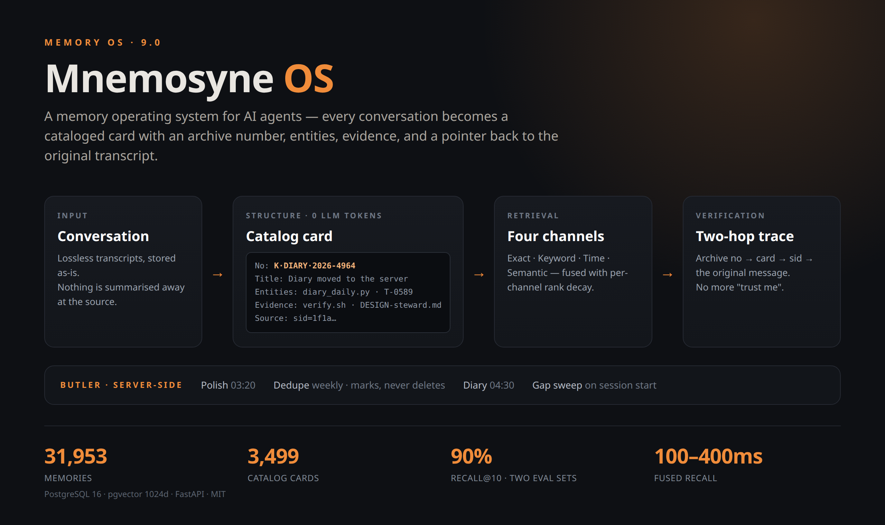
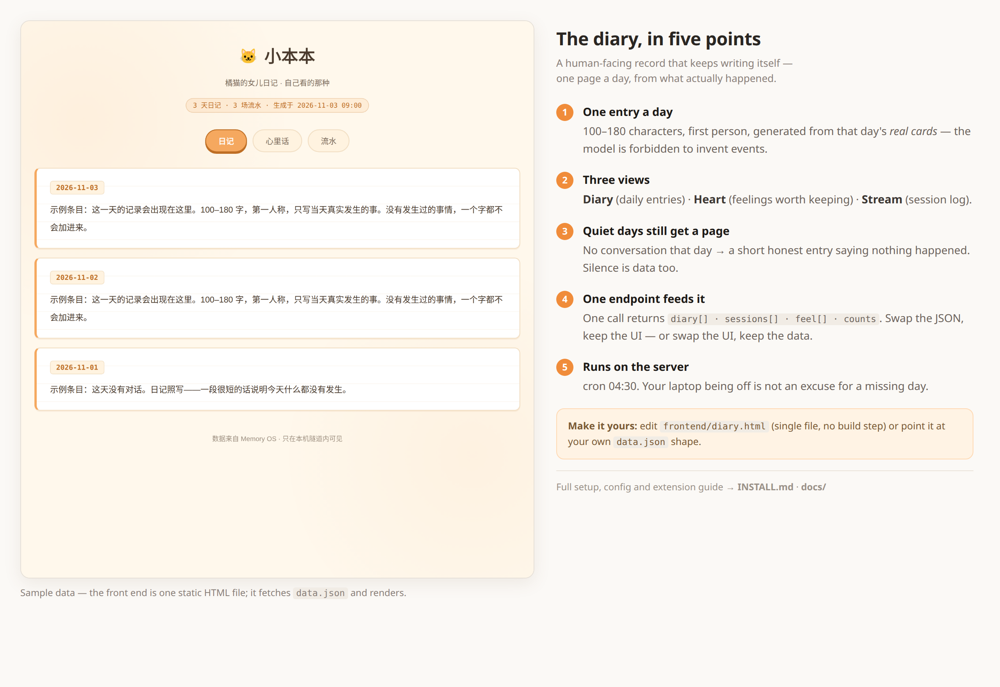

<p align="center">
  
  
  
  
  
  
</p>

<h1 align="center">🏛️ Mnemosyne OS</h1>
<h3 align="center">A memory operating system for AI agents</h3>

<p align="center">
  <i>Not a vector store. Not a RAG pipeline.<br>
  Every conversation becomes a cataloged card — with an archive number, entities,<br>
  evidence, and a pointer back to the original transcript. Plus a diary that keeps running when you don't.</i>
</p>

<p align="center">
  
</p>

<p align="center">
  <a href="#what-it-solves">What it solves</a> ·
  <a href="#the-seven-capabilities">Capabilities</a> ·
  <a href="#the-diary">The diary</a> ·
  <a href="#architecture">Architecture</a> ·
  <a href="#quick-start">Quick Start</a> ·
  <a href="#operations">Operations</a> ·
  <a href="#measured">Measured</a> ·
  <a href="#vs-rag">vs. RAG</a> ·
  <a href="README_CN.md">🇨🇳 中文</a>
</p>

---

| | |
|---|---|
| **Memories** | 31,953 (3,499 catalog cards, 100% embedded) |
| **Recall** | 4 channels fused · 90% recall@10 on two independent eval sets |
| **Trace** | archive no → card → `sid` → original transcript |
| **Butler** | polish / dedupe / diary / gap-sweep — server-side, 7×24 |
| **Diary** | one entry a day, written from real cards only — quiet days included |
| **Stack** | PostgreSQL 16 · pgvector 1024d HNSW · FastAPI |
| **Agent** | Hermes memory provider (14 tools) + REST API + Python SDK + MCP |

---

## What it solves

Long-running agents forget, or worse, remember badly. Five problems that show up in the first month of daily use:

| Problem | What usually happens | What Mnemosyne does |
|---|---|---|
| **Transcripts too long, summaries too lossy** | Blow the context window, or lose the detail you needed | Each meaningful turn becomes a **catalog card**: ≤20-char title, ≤200-char abstract, entity line, evidence line, `sid=` pointer |
| **"I know we discussed this"** | One vector search returns something adjacent but wrong | **Four channels** (exact / keyword / time / semantic) fused with per-channel rank decay, each hit labeled with its channel |
| **Answers cannot be verified** | You can't tell a real memory from a hallucination | Every card carries **evidence** (issue / commit / path / URL); `trace` walks back to the original message |
| **Nothing survives without a human curating it** | The library rots the week you stop maintaining it | **Butler on the server**: polish, dedupe, diary, missed-card sweep — independent of your laptop |
| **Duplicates crowd the top-k** | Two generations of one memory eat two slots | **Dedupe marks, never deletes**; duplicates are down-weighted, one flag removes the mark |

---

## The seven capabilities

### 1. Memory with a shape

```
[Result card] No: K·DIARY·2026-4964
Title: Diary generation moved to the server
Abstract: diary_daily.py + cron 04:30, runs without the laptop; self-test 10/10.
Entities: /opt/.../diary_daily.py · T-0589
Evidence: docs/DESIGN-steward.md · scripts/verify.sh
Tags: DIARY ops
Source: sid=1f1a5a70…
```

Producing this structure costs **zero LLM tokens** — every field is extracted by rules:
archive number from the sequence allocator, entities by eight regex classes (issue id / commit hash /
version / path / URL / number-with-unit / date / project name), evidence by grading persistence
(issue > commit > repo file > URL > absolute path; `/tmp`, `/cache`, `/scratch` are rejected).

A model only improves the **wording** afterwards, and is forbidden from touching the archive number,
evidence or entity lines. The card is a legal document, not a summary.

### 2. Find it back — four channels, one call

| Channel | Mechanism | Weight |
|---|---|---|
| **E** exact | archive no / issue id / commit hash / path — anchored at line start first, full-text fallback | 100 |
| **C** keyword | multi-term OR, scored by coverage (hits ÷ terms, denominator capped at 3) | 60 |
| **T** time | hits inside a recent window, filtered by topic keywords | 45 |
| **S** semantic | 1024-d pgvector HNSW | 40 |

Within each channel, score decays by rank (`K/(K+rank)`, K=10). This matters: flattening a channel into a
single score destroys the ordering the ranking itself produced — we learned that the hard way (§Negative results).

### 3. Two-hop trace

`archive no → card → sid → original conversation`. The vector index is an approximation; the archive number is not.
Anything you can name, you can get back verbatim.

### 4. A butler that runs without you

| Job | When | What it does | Guardrail |
|---|---|---|---|
| Polish | daily 03:20 | Rewrites title + abstract | Never touches archive no / evidence / entities; 20 / 200 char hard caps; idempotent |
| Dedupe | weekly | Mechanical pass (0 tokens, same session + title trigram ≥ 0.8) then model pass for cross-session synonyms | **Marks only**; never deletes or merges |
| Diary | daily 04:30 | Writes the day's entry from real cards | Quiet days get a quiet entry — invented events are forbidden |
| Gap sweep | session start | Reconciles sessions against cards, backfills the difference | Only closed sessions; idempotent |

All four are plain Python jobs on cron. No queue, no worker fleet, no state machine to babysit.

### 5. Tiered retention

Hot / warm / cold with per-tier decay, plus a cold archive that keeps full content recoverable.
Nothing is deleted — it moves, and the move is reversible.

### 6. Palace taxonomy

Memories are also placed in a 7-wing × 20-room tree with library-style call numbers, so **number = position**.
The archive number is not decoration: it is how a human, or an agent, refers to a memory without searching first.

### 7. Agent-native, model-agnostic

Hermes memory provider (14 tools appear after one config line), REST API, Python SDK, MCP server.
Any OpenAI-compatible endpoint: swap `EMBED_MODEL` / `LLM_MODEL_LITE` / `LLM_MODEL_PRO` — no code changes.
Changing the embedding model requires a full re-index; a self-retrieval gate (≥90% top-1) checks it.

---

## The diary

<p align="center">
  
</p>

Most memory systems stop at retrieval. This one also keeps a **diary** — and it is the part people actually
open every morning.

What it is:

- **One entry per day**, 100–180 characters, first person, written from that day's *real* cards only.
  If nothing happened, the entry says so. Inventing events is forbidden in the prompt and checked in review.
- **Three views**: `Diary` (the daily entries) · `Heart` (feelings worth keeping) · `Stream` (the session log:
  what was worked on, how many tool calls, how it ended).
- **Served as one endpoint**: `GET /api/v1/memory-os/diary` returns `{diary[], sessions[], feel[], counts}` —
  the front end is a single static HTML file that fetches `data.json` and renders. No build step, no framework.

Why put it on the server instead of in the client:

> A diary that only exists while your laptop is open is not a diary, it is a session log.
> The job runs at 04:30 on the server. Days you never opened the laptop still get an entry —
> and that entry is honest about nothing having happened.

Wiring it up:

```bash
# 04:30 daily — writes yesterday's entry from cards
30 4 * * * cd /opt/mnemosyne && set -a && . .env && set +a \
  && ./venv/bin/python3 diary_daily.py >> /var/log/diary_daily.log 2>&1
```

To turn it off: `MEMOS_DIARY=0` (job) or remove the cron line. Nothing else depends on it.

---

## Architecture

```
                    ┌──────────────────────────────┐
   agent / user ───▶│  FastAPI · 8.x + 9.0 routers │
                    └───────────┬──────────────────┘
        ┌───────────────────────┼─────────────────────────┐
        ▼                       ▼                         ▼
 ┌─────────────┐        ┌──────────────┐          ┌───────────────┐
 │   Recall    │        │    Cards     │          │    Butler     │
 │ E · C · T · S│◀─────▶│ archive no   │◀────────▶│ polish        │
 │ fuse + decay│        │ entities     │          │ dedupe        │
 └──────┬──────┘        │ evidence     │          │ diary         │
        │               │ sid ─────────┼──▶ transcript store (SQLite ↔ PG)
        │               └──────┬───────┘          └───────────────┘
        ▼                      ▼
  pgvector 1024d HNSW   PostgreSQL 16 · taxonomy (7×20) · entity graph
```

| Layer | Responsibility | Key endpoints |
|---|---|---|
| 9.0 memory OS | recall / exact / keywords / trace / stats / diary / health | `/api/v1/memory-os/*` |
| 8.x palace | taxonomy, summon, refine, lifecycle | `/api/v1/palace/*` |
| Memory CRUD | write, read, feedback, tiers, metrics | `/api/v1/memories/*`, `/api/v1/metrics` |
| Knowledge | wiki snapshots, skills, TMT consolidation | `/api/v1/wiki`, `/api/v1/skills/*`, `/api/v1/tmt/*` |
| Storage | PG 16 + pgvector (vectors) + entity tables + transcript mirror | — |

**Write path**: turn ends → rules extract structure → card inserted with vector of the *index text*
(title + tags, not the whole abstract — a 28-char index beat a 538-char one by 20 points in our own A/B) →
transcript mirrored for trace.

**Read path**: query → route decides which channel(s) matter → channels run in parallel → fusion by
channel weight × rank decay → duplicates down-weighted → top-k.

---

## Quick Start

**Prerequisites** — PostgreSQL 16 with `pgvector ≥ 0.7` (Apache AGE optional, for the entity graph),
Python 3.11+, 8 GB RAM, one OpenAI-compatible LLM + embedding endpoint.

```bash
git clone https://github.com/gymaira1990-jpg/Mnemosyne-OS.git && cd Mnemosyne-OS

# 1. Database (superuser once, for CREATE EXTENSION)
sudo -S -p '' -u postgres createdb mnemosyne
sudo -S -p '' -u postgres psql -d mnemosyne -f docs/schema.sql

# 2. Configure
cp .env.template .env
#    ARK_API_KEY / DEEPSEEK_API_KEY (or any OpenAI-compatible)
#    EMBED_MODEL, LLM_MODEL_LITE, LLM_MODEL_PRO, PGHOST/PGUSER/PGPASSWORD/PGDATABASE

# 3. Install & run
python3 -m venv .venv && . .venv/bin/activate
pip install -r requirements.txt
python3 main.py                      # → http://127.0.0.1:8010

# 4. Verify
curl -s http://127.0.0.1:8010/api/v1/memory-os/health
# → {"status":"ok","router":"memory-os","endpoints":5}
```

**Hermes users** get the shorter path: `hermes config set memory.provider mnemosyne` — 14 tools appear after `/reset`.

Full walkthrough (permissions, model backends, macOS/Windows, FAQ): [INSTALL.md](INSTALL.md).

---

---

## Use it your way

| Your situation | What to do |
|---|---|
| **Already running Hermes** | `hermes config set memory.provider mnemosyne` → 14 tools appear after `/reset`. Nothing else to wire. |
| **Your own agent framework** | Call the REST API (`POST /api/v1/memory-os/recall`, `GET /api/v1/memory-os/trace/{no}`) or import the SDK: `from integrations.sdk import MnemosyneHermesMemory`. |
| **Just want a searchable local store** | You only need 4 tables (`memories`, `entities`, `memory_entities`, `sessions`) and the `/memory-os/*` router. Skip the palace tree, TMT, wiki, skills — they are optional layers. |
| **Want the full thing** | Everything in this repo: catalog cards + palace taxonomy + butler + diary. |

## Make it yours

| What you want to change | Where | Watch out |
|---|---|---|
| Model / provider | `.env`: `EMBED_MODEL`, `LLM_MODEL_LITE`, `LLM_MODEL_PRO` | Changing the **embedding** model invalidates every vector — re-index everything, then run the self-retrieval gate |
| Add a recall channel | `api/memory_os.py` (`_yourchannel`) + the weight table in `sandbox/mem9/recall.py` | Your channel **must return `id`** — returning archive numbers only caused one card to be counted twice and dropped recall from 90% to 70% |
| Change the card format | `jobs/steward_polish.py` → `rebuild_card()` + the line regexes | Archive number, evidence and entity lines are a **contract** for trace; don't let a model rewrite them |
| Add a butler job | new file in `jobs/`, plain Python + cron | Must be idempotent and carry a daily cap — this is the single biggest cost risk |
| Replace the UI | `frontend/*.html` — one static file, `fetch("./data.json")`, no build step | Keep the JSON shape or change both sides |
| Change the diary's voice | `diary_daily.py` → `SYSTEM` / `SYSTEM_QUIET` | Run `--selftest`; the "don't invent events" rule is load-bearing |
| Add auth / multi-tenant | Not built (single-tenant, `user_id=default`) — see ROADMAP | Don't fake it with a token check; the data model has no tenant column yet |

## Deploy shapes

| Shape | Storage | Good for |
|---|---|---|
| **Single node, PostgreSQL** (standard) | PG 16 + pgvector | most self-hosted setups |
| **Edge–cloud** | local SQLite buffer ↔ PG primary | laptops that go offline; buffers writes, flushes on reconnect |
| **Postgres only, no palace** | 4 core tables | smallest footprint — cards, four-channel recall, trace |

All three run the same `main.py`; the difference is which tables and env vars you configure.


## Operations

| Env var | Default | What it does |
|---|---|---|
| `EMBED_MODEL` | — | embedding model id |
| `LLM_MODEL_LITE` / `LLM_MODEL_PRO` | — | cheap / strong chat models |
| `MEMOS_MODEL` | `deepseek-flash` | model used by the butler jobs |
| `MEMOS_POLISH_DAILY_CAP` | `300` | hard daily ceiling for polish (cost guard) |
| `MEMOS_STEWARD` | `1` | set `0` to stop all butler jobs |
| `MEMOS_DEDUPE_SIM` / `MEMOS_DEDUPE_RULE_SIM` | `0.6` / `0.8` | dedupe thresholds |

**Cost shape**: structure extraction is 0 tokens; daily maintenance is one cheap model at low temperature.
Polish is capped per day, dedupe runs weekly, and both skip work that is already marked done.

**Failure handling**: a bad key trips a circuit breaker after 3 consecutive API failures (exit code 2);
malformed model output is retried by halving the batch and only stops after 10 consecutive failures —
because one weird JSON response should not halt a backfill.

---

## Measured

One user, one modest cloud instance (4 vCPU), 7×24:

| Metric | Value |
|---|---|
| Memories | **31,953** |
| Catalog cards | **3,499** — 97.8% with archive no, 100% with vectors |
| Average card length | 337 characters (from transcripts averaging ~33,000) |
| Recall@10 — general set | **9/10 (90%)** |
| Recall@10 — anti-overfit set | **9/10 (90%)** |
| Recall latency | 100–400 ms (four channels, fused) |
| Diary entries | every day, including days with no conversation |

Both eval sets ship with the repo (`eval_recall.py`, `eval_recall_b.py`). The second one deliberately avoids the
domain lexicon, so tuning against the first cannot fake the second.

---

## Negative results (kept on purpose)

We publish the regressions, not just the wins:

| What we tried | Result |
|---|---|
| Whole-abstract embeddings (538 chars) | **worse** than a 28-char index — 20 points of recall@10 lost |
| Merging channel results by archive number | **broke recall** (70%): the semantic channel returns no archive number, so one card became two entries and scores stopped adding up |
| Dedupe that deletes | **rejected**: a mechanical rule misjudged two different cards from one turn — so dedupe only marks and down-weights now |
| Attribute a recall drop to "more data" | **wrong**; it was the merge key. Attribution needs code evidence, not a plausible story |

---

## vs. RAG

| | Typical RAG | Mnemosyne OS |
|---|---|---|
| Unit of memory | a chunk of text | **a card** with archive no, entities, evidence |
| Retrieval | one vector search | **four channels fused**, channel shown per hit |
| Verification | none | `trace` back to the original message |
| Duplicates | pile up | **marked and down-weighted**, never deleted |
| Maintenance | manual | **butler runs on the server** |
| Time awareness | none | time channel + tiered retention |
| Cost to structure | LLM per chunk | **rules: 0 tokens**; the model only improves wording |
| Human-facing record | none | **a daily diary written from real cards** |

---

## Documentation

| | |
|---|---|
| [INSTALL.md](INSTALL.md) | Installation (Linux / macOS / WSL2), model backends, FAQ |
| [AGENTS.md](AGENTS.md) | Manual for AI agents: API surface, env vars, Hermes/MCP |
| [docs/ARCHITECTURE.md](docs/ARCHITECTURE.md) | Internals: layers, fusion, storage |
| [docs/API.md](docs/API.md) · [docs/ENV.md](docs/ENV.md) | REST reference · every environment variable |
| [docs/WHITEPAPER.md](docs/WHITEPAPER.md) · [docs/palace-architecture.md](docs/palace-architecture.md) | Design philosophy |
| [docs/design/](docs/design/) · [docs/adr/](docs/adr/) | Design docs · architecture decision records |
| [ROADMAP.md](ROADMAP.md) · [CHANGELOG.md](CHANGELOG.md) | Where it is going · what changed |

## Version History

| Version | Date | Ships |
|---|---|---|
| [v9.0.2](https://github.com/gymaira1990-jpg/Mnemosyne-OS/releases/tag/v9.0.2) | 2026-11-03 | Doc consistency gate (`make consistency`) + stale-doc fixes |
| [v9.0.1](https://github.com/gymaira1990-jpg/Mnemosyne-OS/releases/tag/v9.0.1) | 2026-11-03 | Docs revision: usage & remix guide, diary walkthrough with annotated UI, deploy shapes, issue templates |
| [v9.0.0](https://github.com/gymaira1990-jpg/Mnemosyne-OS/releases/tag/v9.0.0) | 2026-11-03 | Memory OS：著录卡 · 四通道召回 · 服务端管家 |
| [v8.1.0](https://github.com/gymaira1990-jpg/Mnemosyne-OS/releases/tag/v8.1.0) | 2026-10-26 | Added · Fixed · Docs |
| [v8.0.1](https://github.com/gymaira1990-jpg/Mnemosyne-OS/releases/tag/v8.0.1) | 2026-10-26 | 🧩 Hermes client toolkit: **outcome cards** (per-turn 问/做/证据/`msg_range`, zero-LLM) + `route-search` router (cards → state.db FTS fallback) + 12 contract tests; ♻️ provider drift回流 (+207/−25: self-echo filter · fragment down-weight · session-end backgrounding · upsert · soft-delete mirror) |
| [v8.0.0](https://github.com/gymaira1990-jpg/Mnemosyne-OS/releases/tag/v8.0.0) | 2026-09-25 | 🏛️ Memory OS 8.0（写得对·收得回·找得准·弄得清）: layered write (L0/L1) + idempotency keys per layer · GC batch restore with CASCADE child snapshots · `prod_smoke.py` fixed as P4 gate (6 assertions + auto cleanup) · 7-stage release state machine (`publish` as sole entry) |
| [v7.8.4](https://github.com/gymaira1990-jpg/Mnemosyne-OS/releases/tag/v7.8.4) | 2026-09-24 | 🩹 Fix: archive quality — final report & user messages kept whole (no more 2000-char chop), tool-call evidence signatures, short sessions no longer dropped; ➕ report cards (`category=worklog`) + 23 contract tests |
| [v7.8.3](https://github.com/gymaira1990-jpg/Mnemosyne-OS/releases/tag/v7.8.3) | 2026-09-12 | 🔧 Fix: MNEMOSYNE_PORT / MNEMOSYNE_HOST env vars now effective (server entry no longer hardcodes 127.0.0.1:8010) + docs |
| [v7.8.2](https://github.com/gymaira1990-jpg/Mnemosyne-OS/releases/tag/v7.8.2) | 2026-09-12 | 🩹 Fix: MCP bridge contract (feedback/delete/restore 422 → query params) + capabilities self-description + bridge contract tests |
| [v7.8.1](https://github.com/gymaira1990-jpg/Mnemosyne-OS/releases/tag/v7.8.1) | 2026-08-24 | 🩹 Fix: write-time tokenization (no 24h BM25 blindness), MCP 2.0 adapter, prod↔repo sync |
| [v7.8.0](https://github.com/gymaira1990-jpg/Mnemosyne-OS/releases/tag/v7.8.0) | 2026-08-18 | 🧹 Slim + AGE removal: cut 8 dead assets (memory_chunks/pointer/conversation_messages/halls/tools/projects/response/tome_links), real BM25, dedup fix |
| [v7.7.0](https://github.com/gymaira1990-jpg/Mnemosyne-OS/releases/tag/v7.7.0) | 2026-08-18 | 🚀 Injection Scheduler: procedural skill wing (skill_assets) + /injection/plan + embedding optimization (7.7x faster) |
| [v7.6.2](https://github.com/gymaira1990-jpg/Mnemosyne-OS/releases/tag/v7.6.2) | 2026-08-15 | 🛡 project_id type contract fix + knowledge never frozen (cool floor) |
| [v7.2.0](https://github.com/gymaira1990-jpg/Mnemosyne-OS/releases/tag/v7.2.0) | 2026-08-09 | 🧠 Bjork S/R dual strength + prod tuning (pg_stat_statements/workers/perf alerts) |
| [v7.1.0](https://github.com/gymaira1990-jpg/Mnemosyne-OS/releases/tag/v7.1.0) | 2026-08-09 | 🗄️ Drawerized memory: temp×time dual-track + forget candidates + update endpoint + drawers API |
| [v7.0.0](https://github.com/gymaira1990-jpg/Mnemosyne-OS/releases/tag/v7.0.0) | 2026-08-06 | 🏰 Magic Memory Palace: taxonomy + archive-no + tome cards + 3-channel summon + fact extraction + retention tiers |
| [v6.4.0](https://github.com/gymaira1990-jpg/Mnemosyne-OS/releases/tag/v6.4.0) | 2026-08-05 | Fact extraction: dialogue → personal facts (preference/knowledge) |
| [v6.3.0](https://github.com/gymaira1990-jpg/Mnemosyne-OS/releases/tag/v6.3.0) | 2026-08-05 | Cognitive write signals: importance-boosted initial heat · protected decay |
| [v6.2.0](https://github.com/gymaira1990-jpg/Mnemosyne-OS/releases/tag/v6.2.0) | 2026-08-05 | Cognitive heat engine: hit-heating · differential decay · distill heat |
| [v6.0.1](https://github.com/gymaira1990-jpg/Mnemosyne-OS/releases/tag/v6.0.1) | 2026-08-02 | Production perf: uvicorn workers=2 · recall resilience |
| [v6.0.0](https://github.com/gymaira1990-jpg/Mnemosyne-OS/releases/tag/v6.0.0) | 2026-08-02 | Concept model refactor · TMT pipeline fix · reflector 400x |
| [v5.5.2](https://github.com/gymaira1990-jpg/Mnemosyne-OS/releases/tag/v5.5.2) | 2026-07-29 | NULL embedding search fix |
| [v5.5.1](https://github.com/gymaira1990-jpg/Mnemosyne-OS/releases/tag/v5.5.1) | 2026-07-23 | TMT distillation fix · JSON parsing hardening |
| [v5.5.0](https://github.com/gymaira1990-jpg/Mnemosyne-OS/releases/tag/v5.5.0) | 2026-07-23 | Temporal validity · 39 tests |
| [v5.4.0](https://github.com/gymaira1990-jpg/Mnemosyne-OS/releases/tag/v5.4.0) | 2026-07-23 | Hall gate audit · suggestion API · pytest 18 cases |
| [v5.3.1](https://github.com/gymaira1990-jpg/Mnemosyne-OS/releases/tag/v5.3.1) | 2026-07-16 | Time-ordered search · dual-axis retrieval · `sort=created_at` |
| [v5.3.0](https://github.com/gymaira1990-jpg/Mnemosyne-OS/releases/tag/v5.3.0) | 2026-07-06 | Repo governance · 10-hook Provider · 15-tool MCP |
| v5.2.3 | 2026-07-06 | Downtime alerts · MCP reconnect · L3 distillation |
| v5.2.2 | 2026-06-27 | Full Doubao migration · zero local-model |
| v5.2.1 | 2026-06-27 | Model-agnostic config · env-var backend |
| v5.0.0 | 2026-06-24 | First 7×24 deployment |

[Full changelog →](CHANGELOG.md)

---

---

<p align="center">
  <i>"Memory isn't for storing. It's for living."</i><br><br>
  🐾 <b>G-CAT</b> & <b>Hermes Agent</b> · MIT License · 2026
</p>
