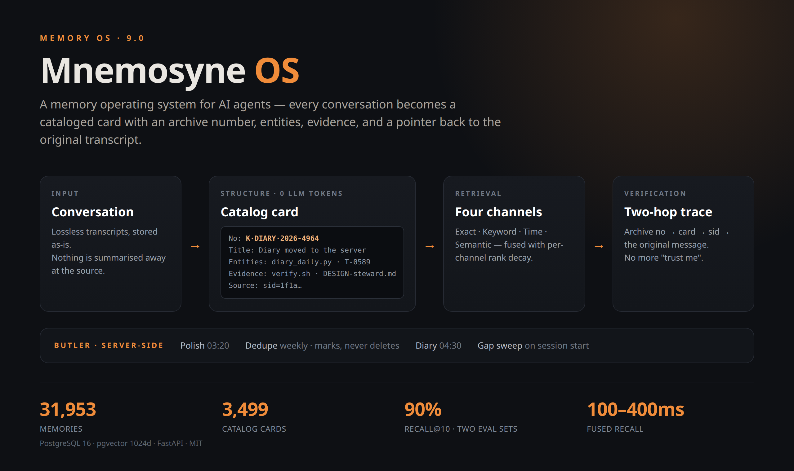
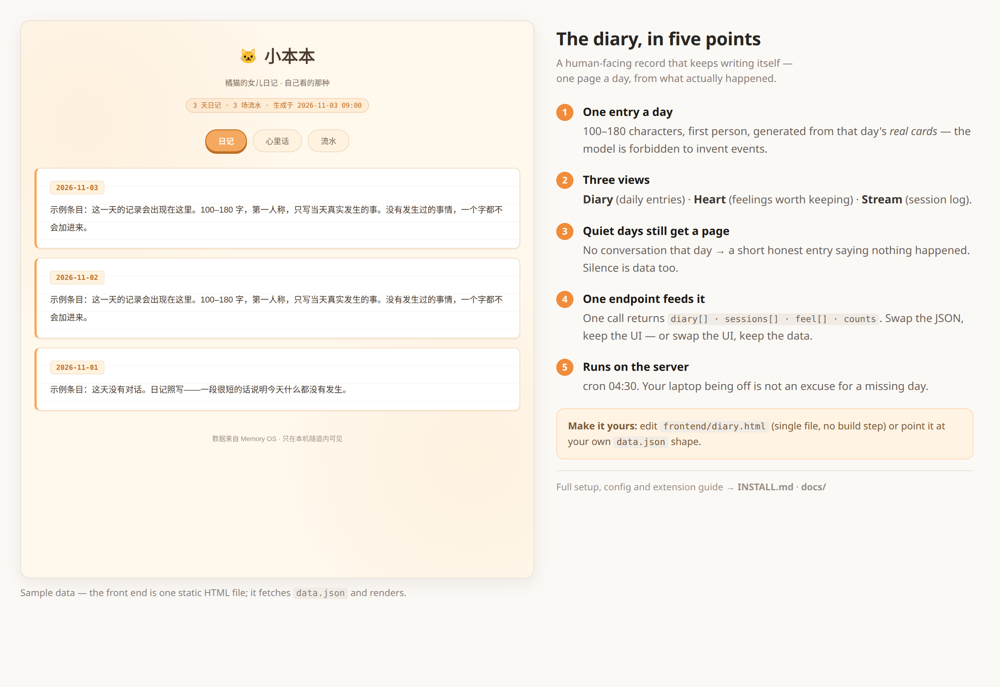

<p align="center">
  
  
  
  
  
  
</p>

<h1 align="center">🏛️ Mnemosyne OS</h1>
<h3 align="center">给 AI Agent 用的记忆操作系统</h3>

<p align="center">
  <i>不是向量库，也不是 RAG 管道。<br>
  每一次有效对话都会变成一张著录卡——带档号、实体、证据行，以及指回原始对话的指针。<br>
  还配一本日记：你不开机它也照写。</i>
</p>

<p align="center">
  
</p>

<p align="center">
  <a href="#它解决什么问题">解决什么</a> ·
  <a href="#七项能力">能力</a> ·
  <a href="#小本本the-diary">小本本</a> ·
  <a href="#架构">架构</a> ·
  <a href="#快速开始">快速开始</a> ·
  <a href="#运维">运维</a> ·
  <a href="#实测">实测</a> ·
  <a href="#负结果照登">负结果</a> ·
  <a href="README.md">🇬🇧 English</a>
</p>

---

| | |
|---|---|
| **记忆量** | 31,953 条（3,499 张著录卡，100% 有向量） |
| **召回** | 四通道融合（服务端 E/C/T · 客户端 S）· 两个评测集各 90% recall@10（第一方自测，脚本不在公开仓） |
| **追溯** | 档号 → 卡片 → `sid` → 原始对话 |
| **管家** | 精修 / 判重 / 日记 / 漏卡巡检 —— 跑在服务器上，7×24 |
| **小本本** | 每天一段人话，只写真实发生的事；没聊的日子也写 |
| **技术栈** | PostgreSQL 16 · pgvector 1024 维 HNSW · FastAPI |
| **接入** | Hermes 记忆提供者（14 个工具）+ REST API + Python SDK + MCP |

---

## 它解决什么问题

长期运行的 Agent 会忘事，更糟的是「记得很糟」。以下五个问题，日常用一个月必然遇到：

| 问题 | 通常的后果 | Mnemosyne 怎么做 |
|---|---|---|
| **原文太长、摘要太糙** | 要么爆上下文，要么丢掉当时要的细节 | 每轮有效对话成为一张**著录卡**：题名 ≤20 字、摘要 ≤200 字、实体行、证据行、`sid=` 指针 |
| **「我记得讨论过」** | 一次向量检索返回「差不多但不对」的东西 | **四通道**（精确/关键词/时间/语义）融合排序，并标出命中的是哪条通道 |
| **答案没法验证** | 分不清是真记忆还是模型编的 | 每张卡带**证据行**（台账/提交/路径/URL）；`trace` 顺档号跳回原始消息 |
| **没人维护就会烂** | 你不整理，库就变成垃圾场 | **服务端管家**：精修、判重、日记、漏卡巡检 —— 不依赖你的电脑开着 |
| **重复卡挤占结果** | 同一件事的两代记录占两个位置 | **判重只标记不删除**；重复卡在召回里降权，撤掉标记即恢复 |

---

## 七项能力

### 1. 记忆是有形状的

```
[结果卡] 档号：K·DIARY·2026-4964
题名：日记生成搬到服务器
摘要：diary_daily.py + cron 04:30，不依赖笔记本开机；自检 10/10。
实体：/opt/.../diary_daily.py · T-0589
证据：docs/DESIGN-steward.md · scripts/verify.sh
标签：DIARY 运维
来源：sid=1f1a5a70…
```

生成这套结构**消耗 0 个 LLM token**，每个字段都由规则抽出：
档号来自序号分配器；实体按八类正则（台账号 / 提交 hash / 版本号 / 路径 / URL / 带单位数字 / 日期 / 项目名）；
证据按持久度分级（台账 > 提交 > 仓库文件 > URL > 绝对路径，`/tmp`、`/cache`、`/scratch` 一律排除）。

模型只负责后续润色措辞，**禁止**碰档号、证据、实体行。**卡片是法律文书，不是摘要。**

### 2. 找得回：四通道（服务端一次出 E/C/T，S 由客户端叠加）

| 通道 | 机制 | 权重 | 跑在哪 |
|---|---|---|---|
| **E** 精确 | 档号 / 台账号 / 提交 hash / 路径——先锚定行首，再全文兜底 | 100 | 服务端 |
| **C** 关键词 | 多词 OR，按覆盖率打分（命中数 ÷ 词数，分母封顶 3） | 60 | 服务端 |
| **T** 时间 | 最近窗口内、且主题词命中 | 45 | 服务端 |
| **S** 语义 | 1024 维 pgvector HNSW | 40 | 客户端叠加 |

> **一句实话**：`/api/v1/memory-os/recall` 一次调用只出 **E/C/T** 三路（纯 SQL —— 同一个请求里再调 embedding，超时就从「可测」变成「不可控」）。
> **S 由客户端取向量后与三路合并**，四通道融合发生在客户端，不是在一次 REST 调用里完成的。
> 只要三路：直接调 `recall`；要四路：照 `integrations/` 的客户端接法叠一次向量检索再合并。

通道内部按排名衰减（`K/(K+rank)`，K=10）。这条很关键：**把通道拍平成一个分数，等于把排序本身丢掉**——我们踩过这个坑（见「负结果」）。

### 3. 两级跳追溯

`档号 → 卡片 → sid → 原始对话`。向量索引是近似，档号不是。
**只要你说得出它是什么，就能原文取回。**

### 4. 不需要你在场的管家

| 作业 | 时间 | 做什么 | 护栏 |
|---|---|---|---|
| 精修 | 每天 03:20 | 重写题名 + 摘要 | 不碰档号/证据/实体；20/200 字硬上限；幂等可续跑 |
| 判重 | 每周 | 机械阶段（0 token，同会话 + 题名 trgm ≥0.8），模型阶段处理跨会话同义 | **只标记**，从不删除或合并 |
| 日记 | 每天 04:30 | 用真实卡片写当天 | 没聊的日子写「没聊」，禁止编造事件 |
| 漏卡巡检 | 会话开始 | 有会话没卡就补 | 只补已结束会话；幂等 |

四个都是 cron 上的普通 Python 作业。没有队列、没有 worker 集群、没有要盯的状态机。

### 5. 分层保留

热/温/冷三层，各自衰减；冷层归档保留全文可恢复。
**没有任何东西被删除，只是换了个位置，而且换得回来。**

### 6. 宫殿分类

记忆同时落在一棵 7 翼 × 20 室的分类树上，配图书馆式索书号，做到「号即位置」。
档号不是装饰：它是人和 Agent 指认某条记忆的方式，不必先搜索。

### 7. Agent 原生、模型无关

Hermes 记忆提供者（改一行配置，14 个工具自动出现）、REST API、Python SDK、MCP 服务端。
任何 OpenAI 兼容端点：换 `EMBED_MODEL` / `LLM_MODEL_LITE` / `LLM_MODEL_PRO`，零改码。
换 embedding 模型必须全量重建索引，并有自检索门禁（top-1 ≥90%）把关。

---

## 小本本（The diary）

<p align="center">
  
</p>

大多数记忆系统做到检索就停了。这套还留了一本**日记**——而它恰恰是每天早上真正会被打开的那一页。

它是什么：

- **每天一条**，100–180 字，第一人称，只用当天**真实卡片**里的事来写。
  什么都没发生，就写什么都没发生；编造事件在 prompt 里是明令禁止的，也要人工抽查。
- **三个视图**：`日记`（每日正文）· `心里话`（值得留下的感受）· `流水`（会话记录：做了什么、多少次工具调用、怎么收的尾）。
- **一个端点供数**：`GET /api/v1/memory-os/diary` 返回 `{diary[], sessions[], feel[], counts}`；
  前端就是一个静态 HTML，`fetch("./data.json")` 然后渲染。没有构建步骤，没有框架。

为什么放在服务器上、而不是客户端：

> 只在你开着电脑时才存在的日记，不叫日记，叫会话日志。
> 作业 04:30 在服务器上跑。你一天没开电脑，那天仍然有一条——而且它诚实地写着「今天没聊」。

怎么接上：

```bash
# 每天 04:30 —— 用卡片写昨天的日记
30 4 * * * cd /opt/mnemosyne && set -a && . .env && set +a \
  && ./venv/bin/python3 diary_daily.py >> /var/log/diary_daily.log 2>&1
```

想关掉：`MEMOS_DIARY=0`（作业级）或直接删掉这行 cron。没有别的东西依赖它。

---

## 架构

```
                    ┌──────────────────────────────┐
   Agent / 用户 ───▶│  FastAPI · 8.x + 9.0 路由     │
                    └───────────┬──────────────────┘
        ┌───────────────────────┼─────────────────────────┐
        ▼                       ▼                         ▼
 ┌─────────────┐        ┌──────────────┐          ┌───────────────┐
 │   召回       │        │    卡片       │          │    管家       │
 │ E·C·T·S 融合│◀─────▶│ 档号/实体/证据│◀────────▶│ 精修 · 判重   │
 │ + 排名衰减   │        │ sid ─────────┼──▶ 会话原文（SQLite ↔ PG）
 └──────┬──────┘        └──────┬───────┘          └───────────────┘
        ▼                      ▼
  pgvector 1024 维 HNSW   PostgreSQL 16 · 分类树(7×20) · 实体图谱
```

| 层 | 职责 | 主要端点 |
|---|---|---|
| 9.0 记忆操作系统 | 召回 / 精确 / 关键词 / 追溯 / 体检 / 日记 / 自检 | `/api/v1/memory-os/*` |
| 8.x 宫殿 | 分类树、召唤、精炼、生命周期 | `/api/v1/palace/*` |
| 记忆读写 | 写入、读取、反馈、分层、指标 | `/api/v1/memories/*`、`/api/v1/metrics` |
| 知识 | Wiki 快照、技能、TMT 整合 | `/api/v1/wiki`、`/api/v1/skills/*`、`/api/v1/tmt/*` |
| 存储 | PG 16 + pgvector（向量）+ 实体表 + 会话镜像 | — |

**写入路径**：一轮结束 → 规则抽结构 → 卡片入库，向量只对**索引文本**（题名+标签）计算
（我们自己的 A/B：28 字索引比 538 字全文高 20 个点）→ 会话镜像落库供追溯。

**读取路径**：查询 → 判层决定用哪几条通道 → 并行取 → 按「通道权重 × 排名衰减」融合 →
重复卡降权 → 取 top-k。

---

## 快速开始

> **要把仓库丢给 AI 去部署？** 让它读 [`DEPLOY-FOR-AI.md`](DEPLOY-FOR-AI.md) —— 每条命令、每步的通过判据、
> 以及「做到哪就该停」的边界都写好了。然后一条命令干活：`bash scripts/bootstrap.sh`。

**前置**：PostgreSQL 16+ + `pgvector ≥ 0.7`（v7.8 起不需要 Apache AGE）、Python 3.11+、8G 内存、
一个 OpenAI 兼容的 LLM + embedding 端点。

```bash
git clone https://github.com/gymaira1990-jpg/Mnemosyne-OS.git && cd Mnemosyne-OS

# 1. 数据库（CREATE EXTENSION 需要一次超级用户）
sudo -u postgres createdb mnemosyne
sudo -u postgres psql -d mnemosyne -f docs/schema.sql

# 2. 配置
cp .env.template .env
#    ARK_API_KEY / DEEPSEEK_API_KEY（或任意 OpenAI 兼容）
#    EMBED_MODEL、LLM_MODEL_LITE、LLM_MODEL_PRO、PGHOST/PGUSER/PGPASSWORD/PGDATABASE

# 3. 安装并启动
python3 -m venv .venv && . .venv/bin/activate
pip install -r requirements.txt
python3 main.py                      # → http://127.0.0.1:8010

# 4. 验证
curl -s http://127.0.0.1:8010/api/v1/memory-os/health
# → {"status":"ok","router":"memory-os","endpoints":5}
```

**两条检索通道，别用错：**

- `POST /api/v1/memories/search` — 搜**原始记忆**（向量 + 关键词）。存进去立刻能搜到。
- `POST /api/v1/memory-os/recall` — 搜**著录卡**（`tome_cards`）。全新安装还没有卡，所以会返回 `candidates: []`，这是正常的、不是坏了；要用 `jobs/` 下的作业出卡，或者先用 `memories/search`。

**Hermes 用户**走更短的路：`hermes config set memory.provider mnemosyne`，`/reset` 之后 14 个工具自动出现。

**跑不起来？让仓库自己告诉缺什么：**

```bash
python3 scripts/doctor.py      # 逐项查 Python / 依赖 / .env / PG / pgvector / 表结构 / 模型 key / 端口
```

每条检查一行输出，失败项直接给修复命令，不用猜。

```bash
python3 scripts/seed_demo.py   # 可选：写入 5 条示例记忆并真跑一次检索
```

示例数据用的是真 embedding，每条都带 `metadata.demo=true` 标记，`--clean` 可一键删除。

完整安装手册（权限、模型后端、macOS/Windows、FAQ）：[INSTALL.md](INSTALL.md)。

---

---

## 三种用法（按你的情况选）

| 你的情况 | 怎么用 |
|---|---|
| **已经在用 Hermes** | `hermes config set memory.provider mnemosyne`，`/reset` 之后 14 个工具自动出现，不用再接别的 |
| **自己的 Agent 框架** | 直接调 REST（`POST /api/v1/memory-os/recall`、`GET /api/v1/memory-os/trace/{档号}`），或 `from integrations.sdk import MnemosyneHermesMemory` |
| **只想要个本地可搜的库** | 只要 4 张表（`memories` / `entities` / `memory_entities` / `sessions`）+ `/memory-os/*` 路由。宫殿树、TMT、Wiki、技能层全部是可选的 |
| **要全套** | 就是本仓库这个形态：著录卡 + 分类树 + 管家 + 日记 |

## 二创指南（改哪里、注意什么）

| 想改什么 | 改哪里 | 注意 |
|---|---|---|
| 换模型 / 供应商 | `.env`：`EMBED_MODEL`、`LLM_MODEL_LITE`、`LLM_MODEL_PRO` | 换 **embedding** 模型等于换向量空间，必须全量重建索引，再跑自检索门禁 |
| 加一条召回通道 | `api/memory_os.py`（`_yourchannel`）+ `recall.py` 的权重表 | 通道**必须返回 `id`**——只返回档号会让同一张卡被算两次，我们把召回从 90% 打到过 70% |
| 改卡片格式 | `jobs/steward_polish.py` 的 `rebuild_card()` 与行正则 | 档号、证据行、实体行是 `trace` 的**契约**，不许让模型改 |
| 加一个管家作业 | `jobs/` 下新建 + cron | 必须幂等 + 有每日上限——这是本项目最大的成本风险点 |
| 换前端 | 仓库**不含**前端：页面自己写，读 `data.json` 或 `/api/v1/*`（见 [docs/PAGES-AND-PORTS.md](docs/PAGES-AND-PORTS.md)） | 要么保持 JSON 结构，要么两边一起改 |
| 改日记口吻 | `diary_daily.py` 的 `SYSTEM` / `SYSTEM_QUIET` | 改完跑 `--selftest`；「不许编造事件」这条是承重墙 |
| 加认证 / 多租户 | 还没做（单租户，`user_id=default`），见 ROADMAP | 别用一个 token 检查假装做了——数据模型里还没有 tenant 列 |

## 部署形态（按「想多省事」选）

| 形态 | 你会得到 | 从哪开始 |
|---|---|---|
| **A · 只跑 API** | REST API + SDK，只绑本机 | [INSTALL.md](INSTALL.md) |
| **B · API + 自己的页面** | 多一个日记页 / 检索页（局域网） | [docs/PAGES-AND-PORTS.md](docs/PAGES-AND-PORTS.md) |
| **C · 公网私人站** | 上面的全部 + 通行密钥登录墙 | [docs/DEPLOY-PRIVATE.md](docs/DEPLOY-PRIVATE.md) · [docs/SECRETS-AND-PASSKEY.md](docs/SECRETS-AND-PASSKEY.md) |

日记不是每天手动写，是**定时作业**：笔记本关机它也照跑 → [docs/DIARY-PIPELINE.md](docs/DIARY-PIPELINE.md)


| 形态 | 存储 | 适合谁 |
|---|---|---|
| **单机 PostgreSQL**（标准） | PG 16 + pgvector | 大多数自托管场景 |
| **边缘-云双活** | 本地 SQLite 缓冲 ↔ PG 主库 | 会离线的笔记本：先写本地，联网再静默推回 |
| **裸 PG、不起宫殿** | 4 张核心表 | 最小占地：卡片 + 四通道召回 + 追溯 |

三种跑的都是同一个 `main.py`，区别只在配了哪些表和哪些环境变量。


## 运维

| 环境变量 | 默认 | 作用 |
|---|---|---|
| `EMBED_MODEL` | — | 向量模型 id |
| `LLM_MODEL_LITE` / `LLM_MODEL_PRO` | — | 廉价 / 强力对话模型 |
| `MEMOS_MODEL` | `deepseek-flash` | 管家作业用的模型 |
| `MEMOS_POLISH_DAILY_CAP` | `300` | 精修每日硬上限（成本闸） |
| `MEMOS_STEWARD` | `1` | 设 `0` 停掉全部管家作业 |
| `MEMOS_DEDUPE_SIM` / `MEMOS_DEDUPE_RULE_SIM` | `0.6` / `0.8` | 判重阈值 |

**成本形状**：结构化抽取 0 token；日常维护是一个廉价模型、低温度。
精修有每日上限，判重每周一次，两者都跳过已标记完成的活。

**失败处理**：坏 key 连续 3 次接口失败即熔断（退出码 2）；
模型返回畸形 JSON 时按批二分重试，连续 10 批才停——一次格式抖动不该让整个回填停摆。

---

## 实测

单用户、一台 4 核云主机、7×24：

| 指标 | 数值 |
|---|---|
| 记忆总量 | **32,383**（快照：2026-11-04） |
| 著录卡 | **3,524 张** —— 97.4% 有档号，100% 有向量 |
| 平均卡长 | 376 字（原始对话平均 ~33,000 字） |
| recall@10（通用集） | **9/10（90%）** |
| recall@10（防过拟合集） | **9/10（90%）** |
| 召回延迟 | 100–400 ms（四通道融合） |

> 表内是**快照**（日期见表）。要看实时值：`GET /api/v1/memory-os/stats?user_id=default`。
| 日记 | 每天一条，含没有对话的日子 |

两个评测集各 10 条中文长对话问题 + 人工标注的期望档号（判据 = 期望卡是否进前 10）。**这两个脚本目前不在公开仓**：
标注指向作者的真实记忆，没法脱敏放出，所以这个 90% 是**第一方自测**，不是你能直接复现的第二方证据。
要自己验：`scripts/seed_demo.py` 灌一套演示数据，按同一判据（期望卡在前 10）自建评测集即可 —— 判据简单，不必信我们的数。

---

## 负结果照登

只报喜的记录是宣传，不是工程。这些是踩过的：

| 尝试 | 结果 |
|---|---|
| 整条摘要算向量（538 字） | **更差**——比 28 字索引低 20 个点 |
| 用档号合并通道结果 | **召回崩到 70%**：语义通道不返回档号，一张卡变成两条，分数不再累加 |
| 判重直接删除重复卡 | **否决**：机械规则误判过同一轮的两张不同卡——现在只标记 + 降权 |
| 把召回下降归因于「语料变多」 | **错**，真因是合并键。归因要代码证据，不要说得通的故事 |

---

## 与传统 RAG 的差别

| | 传统 RAG | Mnemosyne OS |
|---|---|---|
| 记忆单元 | 一段文本块 | **一张卡**（档号/实体/证据） |
| 检索 | 一次向量检索 | **四通道融合**，标出命中通道 |
| 可验证性 | 无 | `trace` 跳回原始消息 |
| 重复 | 越积越多 | **标记 + 降权**，从不删除 |
| 维护 | 靠人 | **管家跑在服务器上** |
| 时间感知 | 无 | 时间通道 + 分层保留 |
| 结构化成本 | 每个块一次 LLM | **规则抽取，0 token**；模型只润色措辞 |
| 给人看的记录 | 无 | **一本用真实卡片写的日记** |

---

## 文档

| | |
|---|---|
| [INSTALL.md](INSTALL.md) | 安装（Linux / macOS / WSL2）、模型后端、FAQ |
| [AGENTS.md](AGENTS.md) | 给 AI Agent 的手册：API 面、环境变量、Hermes/MCP |
| [docs/ARCHITECTURE.md](docs/ARCHITECTURE.md) | 内部结构：分层、融合、存储 |
| [docs/CARD-SPEC.md](docs/CARD-SPEC.md) | **著录卡规范 v1**：7 行结构 · 档号规则 · 证据分级 · 向量化口径 |
| [docs/VERIFICATION.md](docs/VERIFICATION.md) | **自己验**：`make demo && make eval` · 两组实测（92% / 100%）与两个必踩的坑 |
| [evals/](evals/) | 40 张演示卡 + 12 道题 + 原始跑分输出（可复现） |
| [integrations/card-builder/](integrations/card-builder/) | 参考实现：对话 → 卡（纯标准库，可跑通）· [`evals/`](evals/) 召回评测用例 |
| [docs/API.md](docs/API.md) · [docs/ENV.md](docs/ENV.md) | REST 参考 · 全部环境变量 |
| [docs/WHITEPAPER.md](docs/WHITEPAPER.md) · [docs/palace-architecture.md](docs/palace-architecture.md) | 设计哲学 |
| [docs/design/](docs/design/) · [docs/adr/](docs/adr/) | 设计文档 · 架构决策记录 |
| [ROADMAP.md](ROADMAP.md) · [CHANGELOG.md](CHANGELOG.md) | 往哪走 · 改了什么 |

## 版本

| 版本 | 日期 | 发布内容 |
|---|---|---|
| [v9.0.15](https://github.com/gymaira1990-jpg/Mnemosyne-OS/releases/tag/v9.0.15) | 2026-11-04 | 冲突只标记不裁决（人工闸门）· `constraints.txt` 可选锁版本 |
| [v9.0.14](https://github.com/gymaira1990-jpg/Mnemosyne-OS/releases/tag/v9.0.14) | 2026-11-04 | 首页数字改为快照并标日期 · 日记文档标清「作业不在仓库」 |
| [v9.0.13](https://github.com/gymaira1990-jpg/Mnemosyne-OS/releases/tag/v9.0.13) | 2026-11-04 | CI 抓漏修复：演示语料脱敏 + 本地隐私门禁补「内部域名」规则 |
| [v9.0.12](https://github.com/gymaira1990-jpg/Mnemosyne-OS/releases/tag/v9.0.12) | 2026-11-04 | **证据进仓库**：`evals/` 40 卡 12 题 + 两组实测 92%/100% + `make demo && make eval` 一条命令复现 |
| [v9.0.11](https://github.com/gymaira1990-jpg/Mnemosyne-OS/releases/tag/v9.0.11) | 2026-11-04 | **Card Spec v1** + 规范校验器 + 卡片生成参考实现 + `make eval` 召回评测 —— 招牌能力的判据交出去 |
| [v9.0.10](https://github.com/gymaira1990-jpg/Mnemosyne-OS/releases/tag/v9.0.10) | 2026-11-04 | 外部调研打脸版：INSTALL 装不下去的两条 GRANT · embedding 可换后端 · 版本落点扩到 12 处 · `backup.sh` 可验证备份 |
| [v9.0.9](https://github.com/gymaira1990-jpg/Mnemosyne-OS/releases/tag/v9.0.9) | 2026-11-04 | AGENTS.md 补部署入口指针（纯文档） |
| [v9.0.8](https://github.com/gymaira1990-jpg/Mnemosyne-OS/releases/tag/v9.0.8) | 2026-11-04 | 面向 AI 的部署包：`DEPLOY-FOR-AI.md` + 一条命令 `scripts/bootstrap.sh` |
| [v9.0.7](https://github.com/gymaira1990-jpg/Mnemosyne-OS/releases/tag/v9.0.7) | 2026-11-04 | doctor 误报修复（.env 逐键比对 · 端口自检） |
| [v9.0.6](https://github.com/gymaira1990-jpg/Mnemosyne-OS/releases/tag/v9.0.6) | 2026-11-04 | 上手三件套：`doctor.py` 部署自检 + `seed_demo.py` 示例数据 |
| [v9.0.5](https://github.com/gymaira1990-jpg/Mnemosyne-OS/releases/tag/v9.0.5) | 2026-11-04 | 开源可用性修复：.env 真正生效、schema 重建（23 表 / 51 索引）、去掉 AGE 要求 |
| [v9.0.4](https://github.com/gymaira1990-jpg/Mnemosyne-OS/releases/tag/v9.0.4) | 2026-11-04 | 依赖批量升级（fastapi 0.162 / pydantic 2.14）+ 一致性门禁 C8 |
| [v9.0.3](https://github.com/gymaira1990-jpg/Mnemosyne-OS/releases/tag/v9.0.3) | 2026-11-04 | 私人部署文档：通行密钥登录墙 / 日记生产线 / 端口与页面 / 密钥管理 |
| [v9.0.2](https://github.com/gymaira1990-jpg/Mnemosyne-OS/releases/tag/v9.0.2) | 2026-11-03 | Doc consistency gate (`make consistency`) + stale-doc fixes |
| [v9.0.1](https://github.com/gymaira1990-jpg/Mnemosyne-OS/releases/tag/v9.0.1) | 2026-11-03 | Docs revision: usage & remix guide, diary walkthrough with annotated UI, deploy shapes, issue templates |
| [v9.0.0](https://github.com/gymaira1990-jpg/Mnemosyne-OS/releases/tag/v9.0.0) | 2026-11-03 | 记忆操作系统：著录卡 · 四通道召回 · 服务端管家 |
| [v8.1.0](https://github.com/gymaira1990-jpg/Mnemosyne-OS/releases/tag/v8.1.0) | 2026-10-26 | Added · Fixed · Docs |
| [v8.0.1](https://github.com/gymaira1990-jpg/Mnemosyne-OS/releases/tag/v8.0.1) | 2026-10-26 | 🧩 Hermes 客户端工具: **结果卡**(每轮 问/做/证据/`msg_range`, 零模型调用) + `route-search` 检索路由(结果卡 → state.db FTS 兜底) + 12 例契约测试; ♻️ provider 漂移回流(+207/−25: 自回声过滤 · 片段降权 · 会话收尾后台化 · upsert · 软删镜像) |
| [v8.0.0](https://github.com/gymaira1990-jpg/Mnemosyne-OS/releases/tag/v8.0.0) | 2026-09-25 | 🏛️ 记忆宫殿 OS 8.0（写得对·收得回·找得准·弄得清）: 分层写入(L0/L1) + 层内幂等键 · GC 整批还原含 CASCADE 子表快照 · `prod_smoke.py` 固化为 P4 门禁(6 项断言 + 自动清场) · 七阶段发布状态机(`publish` 唯一入口) |
| [v7.8.4](https://github.com/gymaira1990-jpg/Mnemosyne-OS/releases/tag/v7.8.4) | 2026-09-24 | 🩹 修复: 归档质量 —— 收尾汇报与用户消息不再被切(旧版一刀切2000字), 工具调用证据签名入档, 短会话不再静默丢弃; ➕ 汇报卡(category=worklog) + 23 例契约测试 |
| [v7.8.3](https://github.com/gymaira1990-jpg/Mnemosyne-OS/releases/tag/v7.8.3) | 2026-09-12 | 🔧 修复: MNEMOSYNE_PORT / MNEMOSYNE_HOST 环境变量真正生效(服务入口不再写死 127.0.0.1:8010) + 文档同步 |
| [v7.8.2](https://github.com/gymaira1990-jpg/Mnemosyne-OS/releases/tag/v7.8.2) | 2026-09-12 | 🩹 修复: MCP 桥契约(feedback/delete/restore 三方工具 422) + capabilities 自描述对齐 + 契约测试 |
| [v7.8.1](https://github.com/gymaira1990-jpg/Mnemosyne-OS/releases/tag/v7.8.1) | 2026-08-24 | 🩹 修复: 写入即分词(消除当日失明窗口) + MCP 2.0 适配 + 生产仓库对齐 |
| [v7.8.0](https://github.com/gymaira1990-jpg/Mnemosyne-OS/releases/tag/v7.8.0) | 2026-08-18 | 🧹 瘦身+AGE切除: 切除 8 项无消费端资产(memory_chunks/pointer/conversation_messages/halls/tools/projects/response/tome_links) + 真BM25 + dedup修复 |
| [v7.7.0](https://github.com/gymaira1990-jpg/Mnemosyne-OS/releases/tag/v7.7.0) | 2026-08-18 | 🚀 调度大厅: 程序性记忆翼(技能资产) + /injection/plan 注入调度 + embedding 优化(7.7倍提速) |
| [v7.6.2](https://github.com/gymaira1990-jpg/Mnemosyne-OS/releases/tag/v7.6.2) | 2026-08-15 | 🛡 project_id 类型契约修复 + 知识类永不冻结(cool 保底) |
| [v7.2.0](https://github.com/gymaira1990-jpg/Mnemosyne-OS/releases/tag/v7.2.0) | 2026-08-09 | 🧠 Bjork 双强度S/R + 生产调优(pg_stat_statements/workers/水位告警) |
| [v7.1.0](https://github.com/gymaira1990-jpg/Mnemosyne-OS/releases/tag/v7.1.0) | 2026-08-09 | 🗄️ 抽屉化记忆: 温度×时间双轨制 + 遗忘候选 + 更新端点 + 抽屉API |
| [v7.0.0](https://github.com/gymaira1990-jpg/Mnemosyne-OS/releases/tag/v7.0.0) | 2026-08-06 | 🏰 魔法记忆宫殿: 分类树+档号+著录卡片+三通道召唤+资料室事实提取+永恒分级 |
| [v6.4.0](https://github.com/gymaira1990-jpg/Mnemosyne-OS/releases/tag/v6.4.0) | 2026-08-05 | 事实提取管道: 对话→用户事实 (preference/knowledge) |
| [v6.3.0](https://github.com/gymaira1990-jpg/Mnemosyne-OS/releases/tag/v6.3.0) | 2026-08-05 | 认知写入信号: 重要记忆出生即热 · 保护衰减 |
| [v6.2.0](https://github.com/gymaira1990-jpg/Mnemosyne-OS/releases/tag/v6.2.0) | 2026-08-05 | 认知热度引擎: 命中加热 · 差异化衰减 · 蒸馏热度 |
| [v6.0.1](https://github.com/gymaira1990-jpg/Mnemosyne-OS/releases/tag/v6.0.1) | 2026-08-02 | 生产性能: uvicorn workers=2 · recall 容错 |
| [v6.0.0](https://github.com/gymaira1990-jpg/Mnemosyne-OS/releases/tag/v6.0.0) | 2026-08-02 | 概念模型重构 · TMT 管道修复 · reflector 400x |
| [v5.5.2](https://github.com/gymaira1990-jpg/Mnemosyne-OS/releases/tag/v5.5.2) | 2026-07-29 | NULL embedding 搜索修复 |
| [v5.5.1](https://github.com/gymaira1990-jpg/Mnemosyne-OS/releases/tag/v5.5.1) | 2026-07-23 | TMT蒸馏修复 · JSON解析加固 |
| [v5.5.0](https://github.com/gymaira1990-jpg/Mnemosyne-OS/releases/tag/v5.5.0) | 2026-07-23 | 时间有效性 · 39用例 |
| [v5.4.0](https://github.com/gymaira1990-jpg/Mnemosyne-OS/releases/tag/v5.4.0) | 2026-07-23 | 闸机审计 · 建议API · pytest 18用例 |
| [v5.3.1](https://github.com/gymaira1990-jpg/Mnemosyne-OS/releases/tag/v5.3.1) | 2026-07-16 | 时间排序 · 双轴协议 · `sort=created_at` |
| [v5.3.0](https://github.com/gymaira1990-jpg/Mnemosyne-OS/releases/tag/v5.3.0) | 2026-07-06 | 仓库治理 · 10-Hook Provider · 15-Tool MCP |
| v5.2.3 | 2026-07-06 | 宕机告警 · MCP重连 · L3蒸馏 |
| v5.2.2 | 2026-06-27 | 全模块豆包化 · 零本地模型 |
| v5.0.0 | 2026-06-24 | 首次 7×24 部署 |

[完整更新日志 →](CHANGELOG.md)

---

## 文档

| | |
|---|---|
| [INSTALL.md](INSTALL.md) | 分环境安装指南（Linux/macOS/WSL） |
| [AGENTS.md](AGENTS.md) | AI Agent 手册 — API速查/环境变量/Hermes接入 |
| [ROADMAP.md](ROADMAP.md) | 当前 → 下一步 |
| [CHANGELOG.md](CHANGELOG.md) | 完整版本历史 |
| [docs/WHITEPAPER.md](docs/WHITEPAPER.md) | v7.0 产品白皮书 — 宫殿架构 |
| [docs/palace-architecture.md](docs/palace-architecture.md) | 魔法记忆宫殿详细设计 |
| [docs/schema.sql](docs/schema.sql) | 完整数据库结构（含宫殿表） |

---

<p align="center">
  <i>「记忆不是用来存的，是用来活的。」</i><br><br>
  🐾 <b>G-CAT</b> & <b>Hermes Agent</b> · MIT License · 2026
</p>
